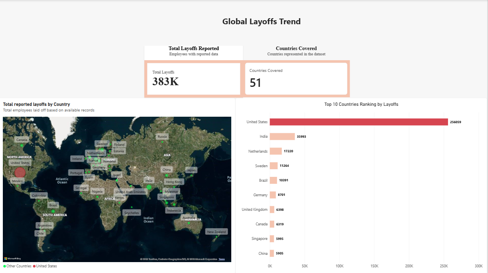
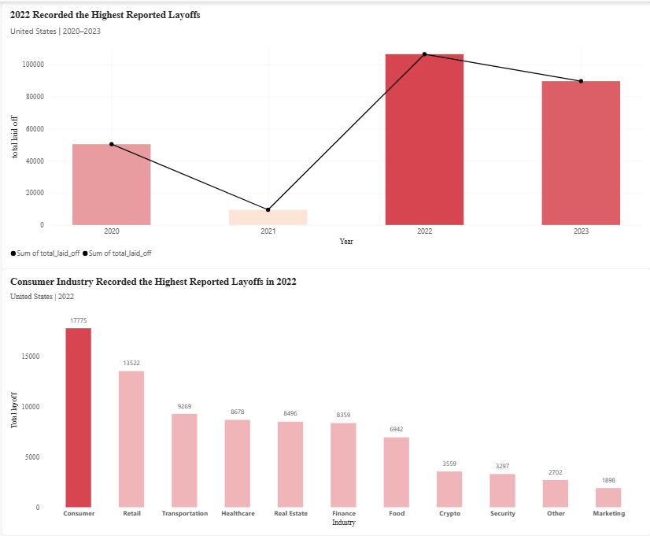

# Global Layoffs Data Analys
## Overview 
This project analyze layoffs data using SQL and Power BI to identify patterns in layoffs across countries, year, industries, companies, and funding stages.
This analysis follows an analytical approach:
Country > Year > Industry > Company > Funding Stage

This project focuses on reported layoffs data and uses SQL for data cleaning and exploratory analysis, followed by Power BI for data visualization

## Business Question
This analysis aims to answer the following questions:
1. Which country recordedthe highest layoffs?
2. Within that country, which year recorded the highest number of layoffs?
3.  Which industry recorded the highest number of layoffs in the peak year?
4. Which companies recorded the highest number of layoffs within the identified industry?
5. Which funding stages accounted for the reported layoffs?

##Tools
- **MySQL**: Data cleansing and exploratory data analysis
- **Power BI**: Data Visualization and dashboard development

## Data Cleansing
The dataset was cleaned using SQL before being analyzed in Power BI.
The main cleaning steps included:
- Identifying and removing duplicate records
- Handling missing value
- Filling missing industry values where a reliable matching record was available
- Removing records where both 'total_laid_off' and 'percentage_laid_off' were unavailable
- Checking data consistency
- Preparing cleaned dataset for EDA process and visualization

Missing value were not removed aimlessly. Records were retained when the available information was still useful for analysis.

## Exploratory Data Analysis
The EDA was structured around the following question:
#### 1. Country
Identify the country with the highest reported number of layoffs.
#### 2. Year
Analyze the yearly trend of reported layoffs within the identified country.
#### 3. Industry
Identify the industry with the highest reported layoffs during the peak year.
#### 4. Funding stage
Analyze reported layoffs across different company funding stages.
#### 5. Funding Stage
Examine company-level contributions within the identified industry.

## Key Findings
Based on the cleaned dataset:
- The higheest country who hold the highest reported layoffs is **United States**, with **256,059 employees** based on available layoff count data.
- **2022** recorded the highest reported layoffs in the United States.
- **Consumer** was the industry with the highest reported layoffs at United States in 2022
- Companies in **Post-IPO** stage funding recorded the highest layoffs within the selected consumer industry segment in the United States in 2022 
- **Meta** recorded the highest company-level reported layoffs within the selected Consumer industry and Post-IPO segment, with **11,000 layoffs**

## Dashboard
The final dashboard was developed in Power BI and consists of three pages.
### Global Layoffs Overview
Provides a global overview of reported layoffs by country, including the top 10 countries by reported layoffs.

### United States Layoff Analysis
Examines yearly reported layoffs in the United States and identifies the industries with the highest reported layoffs in 2022.

### Company & Funding Stage Analysi
Break down into the Consumer industry in the United States during 2022 to examine company-level and funding stage pattern

## Limitation
This analysis is based on reported layoffs data and therefore may not representes all layoffs that occurred during the period covered by the dataset. Some variables contain missing values. These were handled based on their relevance to each analysis, meaning not all missing values were deleted, some missing values remain in the cleaned dataset. The results describe patterns and reported values in the dataset and should not be interpreted as evidence of causal relationships